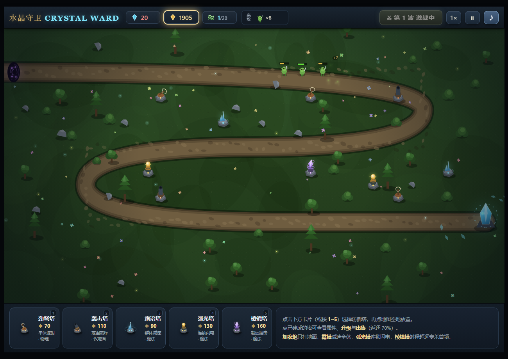

# Crystal Ward · 水晶守卫

**在线试玩：https://xiaocaojimmy.github.io/crystal-ward/**

一个精致的单页 HTML5 Canvas 塔防游戏 —— **零依赖、零图片、零联网**，全部美术与音效都由代码程序化绘制/合成。双击 `index.html` 即可开玩。

## 玩法

魔族沿古道进攻右下角的水晶，漏怪扣生命，归零即败。击杀与过波获得晶钻，用来建造、升级防御塔，撑过 **20 波**胜利，之后可进入**无尽模式**。

## 五种防御塔

| 键 | 塔 | 造价 | 特性 |
|----|------|------|------|
| 1 | 劲弩塔 | ◈70 | 单体速射 · 物理 |
| 2 | 轰击塔 | ◈110 | 范围轰炸 · 仅地面 |
| 3 | 霜语塔 | ◈90 | 群体减速 45~65% |
| 4 | 弧光塔 | ◈130 | 连锁闪电 2~4 跳 |
| 5 | 棱镜塔 | ◈160 | 超远狙击 · 专杀首领 |

每塔可升至 3 级；空中单位无视道路、直线飞越地图对角线突袭水晶——防空盲区是最大的战术陷阱。

## 特性

- 全程序化美术：手绘感地形、双层树冠、花丛、流萤、水晶脉动、漩涡传送门
- 丰富战斗反馈：弹道拖尾、抛物线炮弹带投影、闪电链辉光、击杀爆裂粒子、伤害飘字、屏幕震动、漏怪红色晕影
- WebAudio 实时合成音效（13 种，无音频文件）
- 5 种塔 × 3 级、8 种敌人（含 3 个独立造型首领）、20 波 + 无尽模式
- 升级 / 出售（70% 返还）/ 1~3 倍速 / 暂停 / 静音 / 全键鼠操作

## 操作

`1~5` 选塔 → `左键` 放置（可连续）；点已建塔查看属性 / 升级 / 出售；`右键` `Esc` 取消 · `空格` 暂停 · `F` 加速 · `M` 静音 · `R` 重开。

## 平衡自测

数值经无头浏览器机器人对局回归测试（见 `_dev/test.html`，判读 `document.title`）：机器人 20 波以 5 命通关，各首领逼至压哨残血，失败 / 胜利 / 无尽三条状态流无报错。

## 技术

纯 Vanilla JS，单文件引擎 `game.js`（~1600 行）+ `index.html`。设备像素比自适应，窗口自适应缩放。无任何外部资源，离线可玩。

MIT License.
